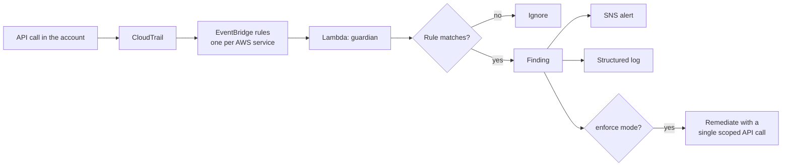

# aws-guardian

Real-time detection and automatic remediation of high-risk changes in an AWS account.

When someone opens SSH to the internet, makes a bucket public, attaches `AdministratorAccess`, or turns off CloudTrail, Guardian sees the API call, alerts on it, and (in enforce mode) reverses it.

- **34 detections** across logging, S3, network, data exposure, IAM and root usage. 19 of them fix the problem automatically; the rest alert only. Full list: [docs/detections.md](docs/detections.md).
- **Mapped to MITRE ATT&CK** (cloud matrix), one or more technique ids per rule.
- **One `terraform apply`** to deploy: trail, event routing, Lambda, least-privilege role, alert topic and a cost budget.
- **88 unit tests**, each rule tested with an event that must fire and benign look-alikes that must not.
- **An attack simulator** that performs the real misconfigurations in a sandbox account and measures the response.

## How it works



1. CloudTrail records management API calls and delivers them to EventBridge.
2. EventBridge rules match only the API calls a rule inspects. The list is generated from the rule registry (`terraform/events.json`), and a test fails if the two drift apart.
3. The Lambda runs the matching rules. Each rule is a small pure function over the CloudTrail event.
4. A finding is logged as JSON, published to SNS, and remediated if the mode allows.

## Design decisions

- **Three modes.** `off` alerts only, `dry_run` (the default) also says what it would fix, `enforce` fixes it. Enforce can be limited to named rules with `remediate_rules`.
- **Remediation permissions exist only in enforce mode.** In the other modes the Lambda role can write its own logs and publish alerts, and nothing else.
- **No wildcard actions and no read access.** Remediation is driven entirely by the event, so the role holds one write action per fix and cannot read data.
- **Narrow fixes.** Opening SSH to the world revokes that one ingress rule, not the security group. A public bucket policy is neutralised by re-applying the public access block, not by deleting the policy.
- **No feedback loops.** Guardian ignores API calls made by its own role, so undoing a change never triggers another finding.
- **Denied attempts are ignored**, except where the attempt is the signal (leaving the AWS Organization, a failed root sign-in).
- **A failed fix never hides the alert.** The finding is still published, with the error.
- **Trusted automation can be exempted** by ARN with `trusted_principals`.

## Deploy

Requires Terraform 1.5+, Python 3.12 and credentials for an account you own. Deploy in `us-east-1`: IAM, root and most console sign-in events are only delivered there.

```sh
cd terraform
cp terraform.tfvars.example terraform.tfvars   # set alert_email
terraform init
terraform apply
```

Confirm the SNS subscription email, then leave it in `dry_run` until the alerts look right. Switch to `remediation_mode = "enforce"` and apply again to turn on fixes.

To remove everything: `terraform destroy`.

## Test it

```sh
pip install pytest boto3
pytest -q                               # unit tests, no AWS access needed

python simulate/attack.py --list
python simulate/attack.py               # run every scenario against the deployed stack
```

The simulator creates throwaway resources, misconfigures them, waits for Guardian to respond, then cleans up and prints each finding with its response latency.

## Adding a detection

1. Add a `Rule` to the right module in `src/guardian/rules/`, with an `evaluate` function and, if it can be fixed safely, a `remediate` function.
2. Add a firing case (and a benign one) to `tests/test_rules.py`. A test fails if any rule lacks a firing case.
3. Regenerate the derived files and, for a new remediation, add its action to `terraform/iam.tf`:

```sh
PYTHONPATH=src python -m guardian.manifest events   > terraform/events.json
PYTHONPATH=src python -m guardian.manifest markdown > docs/detections.md
```

## Limitations

- **It reacts to changes; it does not audit existing state.** A bucket that was already public before deployment is not found. A scheduled posture scan is the planned next step.
- **Management events only.** Data events such as S3 object reads are not inspected.
- **Single account, single region.** Regional services (EC2, RDS, KMS) are only covered in the deployed region. Covering more means deploying per region or forwarding events to one bus.
- **CloudTrail delivery is not instant.** Events usually arrive within seconds to a couple of minutes, so a misconfiguration exists briefly before it is reversed.
- **`ModifySecurityGroupRules` is not covered yet**, only `AuthorizeSecurityGroupIngress`.
- **The alert topic is not KMS-encrypted.** Alerts contain resource names and principal ARNs, not secrets.
- This is a learning and portfolio project. For an organization, use it alongside AWS Config, Security Hub and service control policies, not instead of them.

## Cost

Designed to stay within the AWS free tier at personal-account volume: the first management-event trail is free, and Lambda, EventBridge and SNS usage is a few hundred invocations a month. The module creates a monthly budget alarm (default $5).
